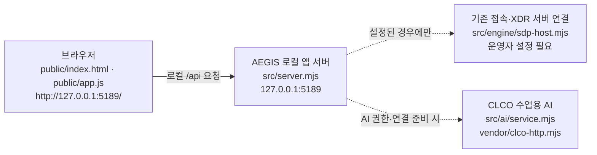

# AEGIS (이지스) 학생 실행 설명서와 구성도

이 문서는 ALEPH 0.2.11 시작 틀 위에 구현한 AEGIS V2를 다른 사람이 실행하고, 화면 결과의 의미와 확인하지 못한 연결을 구분하도록 돕습니다. 제공 [README](../README.md)와 [시작 안내](STUDENT_LAUNCH_GUIDE.md)를 보존한 채 학생 작업을 설명합니다. 앱이 켜진 것, 기존 SDP/XDR 연결, AI 연결, ALEPH 단계 판정은 각각 별개의 결과입니다.

## 목적과 현재 기능

브라우저의 **보호 현황**, **업무 앱**, **보안 기록**에서 로그인 사용자·기기·세션, 앱 접근 판정, 접속/XDR 기록을 확인합니다. 학생 표시 코드는 AI 연결 점검과 사건 설명, 조치 진행 상태, 설치 패키지 취약점 조회 결과도 구분해 보여 줍니다. 연결이 없거나 응답을 확인할 수 없을 때는 이를 성공 또는 안전한 상태로 표시하지 않습니다. 제공 서버가 요청·검증·외부 연동을 맡고, 학생 코드는 전달된 결과를 DOM에 표시합니다.

## 작업 위치와 지원 환경

| 항목 | 이 저장소에서 확인한 값 |
|---|---|
| Git 저장소 | `yxh750501-sys/aegis-security-agent-v2`; Git 최상위는 `on-client`의 부모 폴더 |
| 이 검증 환경의 Git 최상위 | `/workspace/aegis-security-agent-v2` (Linux; Windows PowerShell 실행 결과가 아님) |
| 사용자가 앞서 확인한 Windows 복제 위치 | `C:\Users\User\AppData\Local\ALEPH\Workbench\projects\AEGIS V2` (현재 PC에서 여전히 같은지는 직접 확인 필요) |
| 앱 폴더 | Git 최상위 아래 `on-client` |
| 실제 확인한 도구 버전 | Node.js `v24.19.0`, npm `11.9.0` (이 Linux 환경) |
| 프로젝트 요구 버전 | `package.json`의 Node.js `24.19.0`; 제공 시작 안내는 Node.js 22~24를 안내 |
| 의존성/실행 설정 | `package.json`에 외부 npm 의존성 없음; 추적된 `package-lock.json` 없음; `npm start`, `npm run demo`, `npm run check` 제공 |
| 기본 브라우저 주소 | `http://127.0.0.1:5189/` (현재 PC의 로컬 서버) |

Node.js와 npm, Windows에서는 PowerShell, 앱 화면 확인용 브라우저가 필요합니다. 별도 `npm install`이나 `npm ci` 절차는 이 저장소의 현재 설정에 없습니다. 회사 계정·SDP/XDR·CLCO 접근은 운영자가 준비한 연결과 권한이 있어야 합니다.

## 실행, 종료, 재실행

1. 새 PowerShell 창을 열고 **실제 Git 최상위 폴더**로 이동합니다. 앞서 확인된 Windows 위치가 그대로라면 아래 첫 명령을 사용할 수 있습니다. 다른 위치에 복제했다면 그 경로로 바꿉니다.
2. `git rev-parse --show-toplevel`로 저장소를 확인한 뒤 `on-client`로 들어갑니다. `node --version`으로 Node.js가 준비됐는지 확인합니다.
3. 제공 실행 스크립트를 실행하고, 브라우저에서 표시된 로컬 주소를 엽니다.

```powershell
Set-Location -LiteralPath 'C:\Users\User\AppData\Local\ALEPH\Workbench\projects\AEGIS V2'
git rev-parse --show-toplevel
Set-Location -LiteralPath '.\on-client'
node --version
npm run check
powershell -NoProfile -ExecutionPolicy Bypass -File .\tools\start-alekov.ps1
```

제공 [실행 스크립트](../tools/start-alekov.ps1)가 성공하면 `케셰브가 켜졌습니다. 브라우저에서 http://127.0.0.1:5189/ 을 여세요.`와 `서버가 응답한 것만 확인했습니다. AI 연결 상태는 화면에서 따로 확인해 주세요.`를 표시합니다. 브라우저에서 `http://127.0.0.1:5189/`를 열어 **보호 현황** 화면과 상단 **다시 불러오기** 버튼이 있는지 확인합니다. 이 두 메시지는 앱 서버 응답만 뜻하며 SDP/XDR 또는 AI 연결 성공을 뜻하지 않습니다.

앱을 실행한 PowerShell 창에서 `Ctrl+C`로 종료합니다. 같은 `on-client` 폴더에서 위 스크립트 명령을 다시 실행하면 재시작합니다. 포트 5189를 다른 프로그램이 사용하면 해당 프로그램을 종료하지 말고 `powershell -NoProfile -ExecutionPolicy Bypass -File .\tools\start-alekov.ps1 -Port 5190`으로 켜고 `http://127.0.0.1:5190/`을 엽니다. 제공 스크립트를 사용할 수 없을 때 같은 폴더에서 `npm start`가 기본 미연결 서버를 실행합니다. `npm run demo`는 같은 로컬 주소에서 예제 자료를 보여 주는 별도 실행이며, 예제 결과를 실제 연결로 보지 않습니다.

**검증 범위:** 이 문서를 작성한 Linux 환경에서는 `npm run check`와 `npm start`를 실제 실행했고, 페이지 HTTP 200 및 기본 `/api/me`의 `ENGINE_NOT_CONNECTED` 응답을 확인했습니다. PowerShell 명령과 Windows 브라우저 동작은 제공 스크립트·문서·파일 이름과 대조했지만 이 환경에서 직접 실행하지 못했습니다. Windows에서 새 PowerShell 창으로 위 순서를 재현하는 일은 미확인입니다.

## 실제 코드와 데이터 흐름



브라우저의 [제공 UI](../public/app.js)는 로컬 서버의 `/api/me`, `/api/apps`, `/api/events`, `/api/devices`, `/api/sessions`, `/api/access`, `/api/ai/explain`, `/api/vulnerabilities` 등을 호출하고, 받은 자료를 [학생 표시 함수](../student/extension.mjs)에 전달합니다. `src/server.mjs`는 요청을 검증해 기존 SDP/XDR 연결 코드와 AI 서비스에 필요한 경로를 연결합니다. SDP/XDR과 CLCO 상자의 점선은 **실제 연결이 확인됐다는 표시가 아닙니다.** 기본 실행은 미연결입니다. 설치 패키지 조회는 별도로 `src/vulnerabilities/project-scan.mjs`의 경로를 사용합니다. 이 설명서는 공개 가능한 로컬 주소와 저장소 내 파일 경로만 적습니다.

## 제공 코드와 학생 구현의 경계

[공식 manifest](../.on-starter-manifest.json)의 제공 파일을 기준으로, `public/index.html`과 `public/app.js`는 메뉴·버튼·요청·렌더링 교체를 담당하고, `src/server.mjs`, `src/engine/`, `src/ai/`, `src/vulnerabilities/`, `vendor/`, `tools/`는 제공 서버·연결·실행 경로입니다. `student/engine-adapter.mjs`는 제공 경계의 어댑터입니다. 학생이 구현한 표시 함수는 `student/extension.mjs`의 `createStudentView()`가 반환합니다. 21단계에서는 이 코드와 제공 코드를 수정하지 않았습니다.

| 학생 함수 | 표시 내용 |
|---|---|
| `renderIdentity` | 현재 로그인 사용자·기기·세션과 각각의 목록, 자료별 연결 상태 |
| `renderDecision` | 선택한 업무 앱의 접근 요청·판정 상태와 대상 일치 여부 |
| `renderEvents` | 접속/XDR 기록의 최신순 목록, 필터와 기록 상세 |
| `renderStatus` | 기기·세션 상태, 알림 및 도움정보의 상태 |
| `renderVulnerabilities` | 설치 패키지 조회 상태, 패키지·OSV 응답과 미조회/불확실 상태 |
| `renderAiConnection` | AI 연결 점검의 `idle/loading/ok/error`, `test/verified`, 오류 안내; 사건 설명 실행과 구분 |
| `renderExplanation` | 선택한 사건의 AI 설명, 원문 근거·규칙과 제안; 실패 시 기존 기록 유지 안내 |
| `renderAction` | 미실행·준비·전달·ACK·관측 결과·결과 불명 구분; 준비나 ACK를 효과로 간주하지 않음 |

## 장애별 확인 순서

| 오류 또는 화면 메시지 | 의미 | 사용자가 확인할 사항과 다음 행동 | 현재 검증 상태 |
|---|---|---|---|
| `ENGINE_NOT_CONNECTED`, `연결 없음` | 기본 서버는 켜졌으나 기존 SDP/XDR 연결이 없음. 실제 자료나 승인 결과가 아님. | 운영자가 제공한 SDP 설정 유무를 확인하고 [SDP 연결 안내](SDP_HOST_CONNECTION.md)를 따릅니다. 임의 설정을 만들지 않습니다. | 기본 `/api/me` 응답 직접 확인; 화면 문구는 코드 확인 |
| `NATIVE_HOST_DISABLED` | 이 실행에 계정 연결 설정이 없음. | 운영자가 제공한 Native Host 설정 유무를 확인합니다. 서버 기동만 보고 로그인 완료로 판단하지 않습니다. | 코드 확인; 실제 계정 연결 미확인 |
| `ALEKOV_CONNECT_UNAVAILABLE` | 앱 내부 AI 승인 연결을 사용할 수 없음. | [연결 문제 안내](CONNECTION_TROUBLESHOOT.md)의 코드별 절차로 배포본·운영자 준비 상태를 확인합니다. | 코드 확인; 실제 AI 연결 미확인 |
| `ON_AI_PROVISIONING_PENDING` | 현재 계정 또는 앱의 AI 이용 권한이 준비 중이거나 확인 불가. | 계정 연결과 AI 앱 승인을 확인하고, 계속되면 담당자에게 권한 상태를 문의합니다. | 코드 확인; 실제 운영 권한 미확인 |
| `CONTRACT_MISMATCH`, `확인 불가(unknown)` | 응답 형식·확인 범위·상태를 신뢰할 수 없음. 빈 결과나 성공으로 처리하지 않음. | 상단 **다시 불러오기**를 한 번 눌러 재조회하고, 계속되면 도움정보를 담당자에게 전달합니다. | 코드 확인; 실제 계약 오류 재현 미확인 |
| `기록을 불러오지 못했습니다` | 보안 기록 요청 오류. 빈 기록과 다름. | 오류 문구를 읽고 연결 상태를 확인한 뒤 **다시 불러오기**를 직접 누릅니다. | `renderEvents` 코드 확인; 실제 조회 실패 미확인 |
| `AI 연결 점검 실패`, `AI 설명 실패` | 점검과 사건 설명은 별도 요청이며 실패도 구분됨. | 표시된 안전한 오류 코드·안내를 읽고 계정·권한·시간 제한을 확인합니다. 필요하면 사용자가 해당 버튼으로 직접 다시 요청합니다. | 표시 코드 확인; 실제 CLCO 호출 미확인 |
| `설치 패키지 조회 실패(error)` | 취약점 조회 요청 실패. 이전 결과를 현재 결과로 보지 않음. | 오류 문구를 확인하고 제공 화면의 조회 버튼을 직접 다시 누릅니다. | `renderVulnerabilities` 코드 확인; 실제 OSV 조회 미확인 |
| `아직 조회 안 함 (not_checked)`, `일부 조회 실패 (partial)` | 미조회는 취약점 없음이 아니며, 일부 조회는 전체 결과를 확정할 수 없음. | 조회 대상 설정과 각 패키지의 조회 상태를 확인합니다. 확인된 취약점 ID만 사용합니다. | 표시 코드 확인; 실제 OSV 조회 미확인 |
| `결과 불명(unknown)` | 조치 효과나 실패를 확정할 수 없음. | 준비·ACK를 효과 확인으로 보지 말고 원천 결과만 다시 조회합니다. | `renderAction` 코드 확인; 실제 조치 미실행 |
| `Node.js 가 없습니다`, `…초 안에 뜨지 않았습니다` | 제공 실행 스크립트가 서버 시작을 완료하지 못함. | Node.js 버전과 앱 폴더 위치를 확인하고, 계속되면 오류 메시지를 담당자에게 전달합니다. | 스크립트 코드 확인; Windows 실행 미확인 |
| `포트 5189 를 다른 프로그램이 쓰고 있습니다` | 로컬 주소 충돌. | 위 `-Port 5190` 명령으로 실행하고 브라우저 포트도 바꿉니다. | 스크립트 코드 확인; Windows 충돌 재현 미확인 |

오류 코드별 상세 구분은 제공 [연결 문제 안내](CONNECTION_TROUBLESHOOT.md)에 있습니다. 도움정보를 공유하기 전에는 화면 내용을 직접 확인하고, 키·토큰·비밀번호·개인 설정 파일을 문서나 커밋에 넣지 않습니다.

## 확인한 범위와 기다림(UNV)

| 구분 | 근거와 범위 |
|---|---|
| 코드 확인 | 메뉴와 API 연결, 학생 함수 8개, PowerShell 실행 스크립트·오류 문구를 실제 파일에서 대조함. 이는 실행 성공 증거가 아님. |
| 직접 실행 확인 | Linux에서 Node.js `v24.19.0`, npm `11.9.0`, `npm run check` 통과, `npm start` 시작, `http://127.0.0.1:5189/` HTTP 200, 기본 `/api/me`의 `ENGINE_NOT_CONNECTED` 확인. |
| 앞 단계의 별도 검증 | 이전 단계에서 모의 DOM·Chromium 예제 화면을 점검했음. 이번 문서가 실제 회사 연결을 재검증한 것은 아님. |
| 기다림(UNV) | 새 Windows PowerShell 창에서 본 문서만으로 재실행, 현재 PC의 실제 경로·버튼 대조, 운영 계정 인증, 실제 SDP/XDR 자료·접근 판정, CLCO 모델 호출·사건 설명, 조치 집행·효과, 실제 OSV 응답·설치 패키지 대조. |

`npm run check`는 `student/extension.mjs`의 문법 검사만 합니다. HTTP 200은 앱 서버 응답 확인일 뿐, 위의 기다림(UNV)을 통과로 바꾸지 않습니다. ALEPH 공식 단계 판정은 제출 커밋의 원문을 별도로 검토합니다.

## 최종 과제 3일차: 연결과 Windows 기록 재현

Windows PC의 실제 테스트용 복제본이 `C:\Users\User\Downloads\AEGIS-V2-day1`에 있다면, 변경 사항을 반영한 뒤 아래 순서로 실행합니다. 경로가 다르면 본인의 복제본 경로로 바꿉니다. 이미 실행 중인 앱 서버는 먼저 해당 창에서 `Ctrl+C`로 끄고 재시작해야 새 코드가 적용됩니다.

```powershell
git -C 'C:\Users\User\Downloads\AEGIS-V2-day1' pull --ff-only origin main
npm.cmd --prefix 'C:\Users\User\Downloads\AEGIS-V2-day1\on-client' run check
powershell -NoProfile -ExecutionPolicy Bypass -File 'C:\Users\User\Downloads\AEGIS-V2-day1\on-client\tools\start-alekov.ps1'
```

1. 브라우저에서 `http://127.0.0.1:5189/`를 열고 **보호 현황 → 연결과 Windows 기록**을 확인합니다.
2. 활성 네트워크 인터페이스 주소, 방화벽 프로필, 최근 24시간 System·Application 경고·오류 건수 옆의 조회 시각을 확인합니다. 이 영역은 로컬 앱 서버가 읽은 **실제 조회값**만 표시하며 설명용 예시 수치를 넣지 않습니다.
3. 상단 **다시 불러오기**를 누르고 조회·집계 시각이 갱신되는지 확인합니다. 읽지 못하는 항목은 `확인 불가`와 이유로 남아야 합니다. 관리자 권한 상승이나 보안 설정 변경을 시도하지 않습니다.
4. 별도 **SDP 서버** 행을 확인합니다. 상단 `연결 없음`이라면 `SDP 미연결`이어야 합니다. PC 조회 성공은 SDP 연결 성공을 뜻하지 않습니다.

System·Application 건수는 운영체제 경고·오류 기록의 개수이며 **침해나 공격 탐지 결과가 아닙니다.** 방화벽 조회는 프로필과 기본 정책을 읽기만 합니다. 이벤트 본문은 앱 서버 응답에 넣지 않습니다. 이 문서를 추가한 클라우드 Linux 환경에서는 Windows PowerShell·이벤트 로그를 실행할 수 없으므로, Windows PC의 실제 결과는 사용자가 위 화면에서 확인하기 전까지 미확인입니다.

## 21단계 제출 시 확인할 것

학생 문서를 커밋한 **40자리 SHA**와 저장소 주소가 같은 커밋을 가리키는지 확인합니다. 현재 Workbench의 **포털 제출 준비**는 13~20단계용이므로 21단계는 과제 화면에서 저장소 주소와 커밋을 직접 입력합니다. 비공개 원문 묶음이 필요하면 과제 화면의 **비공개 저장소 원문 준비 방법**에 있는 도구를 프로젝트 밖에 풀고, Git 최상위에서 그 화면에 안내된 명령에 실제 도구 경로·출력 경로·커밋을 넣어 JSON을 생성합니다. JSON은 프로젝트 밖에 보관합니다. 원문 접수와 공식 판정 통과는 별개이며, 앱을 켜거나 이 문서를 쓴 것만으로 제출되지 않습니다.
